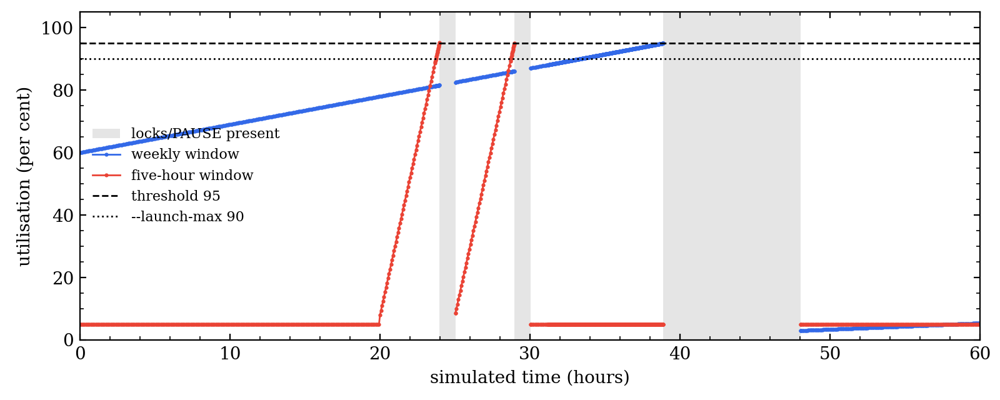

# Harness of wave 3 (2026-11-20, 22:00-22:35Z; paused)

Written by the harness helper of the orchestrator, from the main checkout. Stopped at 22:34Z because
`locks/PAUSE` appeared (five-hour window 97 per cent, reset at 02:50Z). Commits on main: `927da628`,
`8e3e9bc4`, `f19ea173`, `fd87e7ef`, `0be74bb1` and the commit of this digest. Owners get the commands
with `nrpic-ctx sync`.

## Done

| Part of the task | Result | Test |
|---|---|---|
| (a) `nrpic-doctor --all`, rows git | 22:14Z: git PASS in all nine worktrees (hook installed by `core.hooksPath`; a 6 MB file and a fake secret refused). At 22:30Z git FAIL everywhere only because the agents had uncommitted work (the brief's row asks for a clean tree); the row now prints the hook's verdict as well. kb FAIL in all nine: `kb status` counts the rows of the kb writer's working database and took more than 400 s during kb's ingest (other sessions' `kb status` calls ran 11 to 13 minutes); the row now runs once per distinct `kb/` tree with 180 s. Nothing in the hook needed a fix | `scratch/harness/logs/doctor-all-*` |
| (a) `harness/RULES.md` | hook installed 2026-11-20 and what it does not see; CLAUDE.md's escape rule; the pause flag in "Every session" and a section "Pause flag and nrpic-usage" (probe, show, watch, resume); waivers; orch's runs; `--wait`; batch restarts and cold dumps (E's note); test counts | |
| (b) `nrpic-stage verify` reads main's committed `coord/WAIVERS.md` (decision 0019 item 6) | a run id at the start of a line, then the reason; its failures of the manifest check go to `runs-waived` with the reason; a working-tree copy does not count | `test_nrpic_stage.py` 50/50 |
| (c) `nrpic-run submit` for owner orch | manifest `tracks/orch/runs/<run_id>/` on main, output `scratch/orch/<run_id>/`; cleanliness as with `--package` (code roots, packages, inputs); path-limited commit that waits for `index.lock`; no card-hours, six cores without a row in 0006 | `test_nrpic_run.py`: commit made while another writer held the lock 7 s, another agent's staged, modified and untracked files untouched |
| (d) self-test of `nrpic-usage` | `Usage(root, service, clock, sleep)` behind the unchanged command line; recorded streams, simulated clock, scratch root; the live flag checked unchanged, the service never reached | `test_nrpic_usage.py` 25/25; figure `usage-selftest.png` |
| (d) defect found and fixed | `resume` lifted the flag only when every window was below `--near`: with the orchestrator's `resume --near 60`, a five-hour pause while the weekly window stood at 60 to 95 per cent would have held every agent until the weekly reset. Now the tripped window must be below `--near` and the others below `--launch-max` (90, decision 0018); a second high window holds the flag with its own reset time. Six probes without a reading now write the flag (`unknown`; decision 0018) instead of exiting without one. New `watch --cycle` | same |
| (e) hook watch | `harness/tests/hook_watch.py` (read-only). Sweep 22:26Z: 370 commits (30 merges) since the installation at 21:57Z, none that the hook refuses; the words occur only in merge notes; none in uncommitted worktree files | |
| requests to the harness | C `lead-core-share`: `nrpic-run submit --wait SECONDS`. Wave-2b open item: `finish`, `stop`, `status`, `lint` read schema-copying hand registrations as hand-written. E `harness-batch-restart-and-cold-reads`: two lines in RULES.md | `test_nrpic_run.py` 73/73 |

*The `--cycle` scenario of the self-test: simulated utilisation of the weekly (blue) and five-hour (red)
window against time, threshold 95 (dashed), `--launch-max` 90 (dotted); grey where `locks/PAUSE`
existed. Two five-hour pauses are lifted at the five-hour resets (weekly 82.5 and 87, below 90), the
weekly pause at the weekly reset.*

## Not done (restart from here)

1. (f) `coord/BOARD.md` (`python3 -I harness/bin/nrpic-ctx board --write`) and `coord/REQUESTS.md`:
   47 messages since the last state (2026-11-19T14:35Z), 22 of them requests or proposals; the list is
   in `scratch/harness/requests/msgs-since-wave2b.json` (`scratch/harness/requests/dump_msgs.py`).
2. (e) hourly sweeps after 22:26Z: `python3 -I harness/tests/hook_watch.py --json
   scratch/harness/hook-watch/<UTC>.json`.
3. Live check of the waiver: `nrpic-stage verify B-emd-gw G1 --no-rerun` from main (with checksums;
   stopped at the pause, more than 7 minutes).
4. The full `harness/tests/run-runs-config-tests` after the changes (run individually: run 73, stage
   50, usage 25).

## For the orchestrator

- The running `nrpic-usage watch` and `resume --near 60` (started 13:59 PST) run the code from before
  `8e3e9bc4`. For this pause the old `resume` lifts the flag after 02:50Z because the weekly window
  resets at 23:00Z; restart both (or one `watch --cycle`) to get the fix.
- `coord/WAIVERS.md`: F's three runs of `wave2-run-dirs-unchecksummed` (F-20261115-173719-923135a,
  F-20261115-181805-f9c3473, F-20261115-182100-613c9c6) need a ruling; a waiver is one line each.
- kb: `kb status` is too slow to be a health check while kb ingests.
