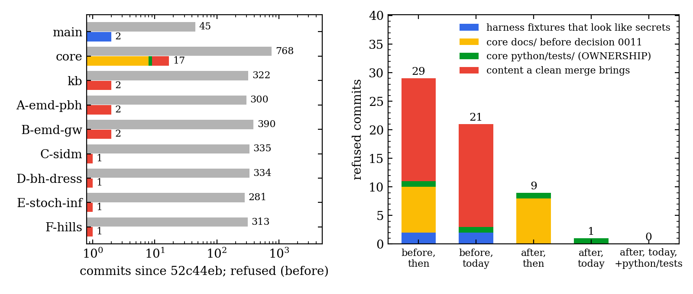

# Dry run of the pre-commit hook over the history (wave 3a, 2026-11-19)

Decision 0017 item 4: the git pre-commit hook of `harness/hooks/` is installed between waves, and only
after a dry run over the existing history of every owner branch shows that it would not have refused
a legitimate commit. This is that dry run. Nothing was installed; no live branch, index or worktree
was written.

**Result.** Every commit since the start of the program (`52c44eb`) on all 32 owner branches was
replayed through the hook: 3088 commits, 72 of them merges. The hook as it stood (`d33452b5`,
refactored without change of behaviour in `b0f3b86b`) would have refused 11 commits where it runs and
18 clean merges of main had they conflicted. **None of the 29 is a true finding.** 11 are
legitimate commits and 18 show a defect of the hook. The corrected hook (`4cbb8edf`) refuses one
commit with today's OWNERSHIP: core's unit test under `python/tests/`. It refuses none once main's
OWNERSHIP of core lists `python/tests/**`, which is request 1 below.



*Left: commits replayed per owner (grey) and the commits the hook before the corrections refuses,
coloured by class (OWNERSHIP of each commit's time; log scale). Right: refused commits per class for
the five runs of the table "Rerun" below. "Then" means main's OWNERSHIP at the commit's time,
"today" means main's OWNERSHIP now.*

## Method

`harness/tests/precommit_dryrun.py` (read-only) passes each commit through `evaluate(view)`, the
function that holds the hook's checks. In place of the index it uses a view of the commit:

- the files changed against the first parent, their blobs, sizes and added lines;
- the branch the commit was made on, taken as the first branch in the order main, kb/main,
  core/nrpic, track/\<ID\>, then the temporary branches (each only for commits after its creation,
  from its reflog), whose first-parent chain holds the commit;
- main's OWNERSHIP at the commit's time (`--ownership at-time`) or today (`tip`).

Merges are replayed in a scratch clone (`scratch/harness/hook-dryrun/clone*`, `git clone
--shared`). Plain `git merge` does not run pre-commit, so the hook runs on a merge only when a
conflict was resolved and the merge was finished with `git commit`. A merge whose automatic result
equals the recorded tree is "clean": 70 merges were clean and 2 were resolved (`dc93a727` and
`66bd4c35`, both into core/nrpic; both pass every version of the hook). Clean merges are still
evaluated, as if they had conflicted, and are counted apart.

Two independent cross-checks support the replay:

- No blob above 5 MB was added in the range. The largest is 1.5 MB (`git rev-list --objects` with
  `cat-file --batch-check`).
- The replay finds no manifest to refuse among the 2883 manifest versions under
  `tracks/<ID>/runs/<run_id>/`: each is a JSON object whose run_id equals the directory and fits
  the pattern. A separate script that read the 2732 versions present at 15:40 UTC agrees.
- A separate scan of every added line with the old patterns finds the same two commits as the
  hook.

## Refusals of the hook before the corrections, by class

OWNERSHIP of the commit's time. Times are UTC, 2026-11-15 unless stated otherwise.

| Class | Commit | Branch | Check | Path | Why | Correction |
|---|---|---|---|---|---|---|
| legitimate | `270dfb3e` 11:38 | main | secret | `harness/bin/nrpic-doctor` | the doctor's [git] probe writes a fake: an OpenSSH key header with a 42-character stub and the AWS documentation example secret | hook: documentation placeholders pass |
| legitimate | `d33452b5` 15:45 | main | secret | `harness/tests/test_precommit.py` | the hook's own test: a key header with a three-letter body and an API key made of the alphabet | hook: documentation placeholders pass |
| legitimate | `408df577` 11:36 | core/id-extrinsic | foreign | `docs/FORMATS.md` | core's format documents; `docs/**` reached core's OWNERSHIP with decision 0011 (`cac6f0ad`, 15:16) | none needed: passes with today's OWNERSHIP |
| legitimate | `38f5c95c` 12:03, `b587cdb0` 13:20, `9343f6ed` 13:21 | core/multi-puncture | foreign | `docs/FORMATS.md` | the same | the same |
| legitimate | `fb0491ac` 12:16 | core/rng | foreign | `docs/RNG.md` | the same | the same |
| legitimate | `dc623d19` 12:17 | core/newton | foreign | `docs/FORMATS.md` | the same | the same |
| legitimate | `d8796f22` 14:37, `831b4d29` 14:40 | core/collisions | foreign | `docs/COLLISIONS.md` | the same | the same |
| legitimate | `09848a1a` 2026-11-19 14:57 | core/oblate | foreign | `python/tests/test_oblate_spheroid.py` | `python/tests/` holds the tests of `python/nrpic/` (core's code; the three earlier tests there date from the rebuild of 2026-11-13); core's OWNERSHIP lacks it | OWNERSHIP of core on main: add `python/tests/**` (request 1) |
| defect | 18 clean merges of main (below) | core/nrpic, core/requests-b, core/requests-adf, core/gauge, core/collisions-2, core/clump-curvature, core/id-solver, core/scalar-2, kb/main (2), track/A (2), track/B (2), track/C, track/D, track/E, track/F | secret | the two fixtures above, arriving from main | had any of them conflicted, checks 1 to 3 would have run over everything main brought and refused the two harness fixtures | hook: in a merge only what the resolution adds is checked |
| true finding | none | | | | | |

The 18 merges are `74ed745a`, `4b9e24f0`, `6bb93369`, `3b8a5c93`, `98297676`, `3f710a38`,
`b7034c96`, `f46f159f`, `4c6c0f70`, `e63868ce`, `73593899`, `ab894727`, `d1c5414a`, `f3d772d2`,
`8e259d3c`, `cbbdfe01`, `c27eecf2` and `dd03e16b`. No commit was refused for size or for a run
manifest. The checks for size, manifests and foreign paths are unchanged.

## Corrections made (commit `4cbb8edf`; refactor of the checks into `evaluate(view)` in `b0f3b86b`)

1. **Placeholders are not secrets.** A match passes when its value is a documentation placeholder:
   - it contains `EXAMPLE` (the AWS documentation keys);
   - it has a run of eight consecutive characters (as in abcdefgh or 12345678);
   - it has a run of eight equal characters.

   A private key block counts only when its body carries at least 120 base64 characters, in runs of
   40 or more up to the END line, with the literal `\n` escapes of a key inside a string joined. The
   smallest real key, an EC P-256 key, has about 160. Random 20- to 40-character secrets essentially
   never contain such runs, so real-shaped fakes are still refused (tests below).
2. **Merges.** When MERGE_HEAD exists, a file whose content equals a merged branch's is skipped by
   the checks for size, secrets and manifests, because it was checked where it was committed. In a
   file resolved by hand, only lines found in neither HEAD nor a merged branch count as added. The
   check for foreign paths still skips merges, as before.
3. **The scan of added lines no longer goes blind.** Each of the following used to stop the scan
   for a whole file or commit. None appears in the history, and the test of each failed with the old
   hook:
   - an added line beginning `++` (it shows in the diff as `+++` and reset the current file);
   - a file name that git quotes (one with a double quote, a backslash or a control character);
   - `diff.noprefix` or `diff.mnemonicPrefix` in a user's git configuration.

   The hook now treats `+++` as a file name only in a diff header, unquotes file names, and passes
   fixed `a/` and `b/` prefixes with `core.quotePath=false`.
4. Sizes and blobs are read in one batch from the `--raw` diff.
5. `nrpic-doctor`'s [git] probe and `harness/tests/test_precommit.py` build real-shaped fakes at
   run time, so that none of their own lines looks like a secret.

Tests:

- `harness/tests/test_precommit.py`: **25/25** with `4cbb8edf`. The 13 earlier checks remain
  (the two secret checks now use real-shaped fakes), and 12 are new: placeholders accepted, a real-shaped AWS secret and a key in a JSON string rejected,
  the three blind spots, a conflicted merge of main that brings a secret-looking fixture and a 6 MB
  file accepted, a resolution that adds a secret rejected, and `python/tests/` refused until main's
  OWNERSHIP of core lists it. With the hook of `b0f3b86b` the result is 18/25, and exactly the 7
  checks of corrections 1 to 3 fail.
- `harness/tests/test_precommit_dryrun.py`: **9/9**. It checks the replay itself on a scratch
  history: a foreign path and a secret are found; clean and resolved merges are recognised; a commit
  of a branch that only a merge message names is attributed; OWNERSHIP of the time and of today are
  both handled; the repository under test is not written.
- `harness/tests/run-runs-config-tests`: 0 files with failures (env 15, run 57, style 10, stage 45,
  hooks 99, configuration 51, fetch 29, pre-commit 25, dry run 9).
- `harness/bin/nrpic-doctor --rows git`: "6 MB file rejected, fake secret rejected" (MISSING
  only because the hook is not installed).

## Rerun

Every run covers the same 3088 commits and 72 merges.

| Hook | OWNERSHIP | Refused where the hook runs | Clean merges refused | Total |
|---|---|---|---|---|
| `b0f3b86b` (before) | of the commit's time | 11 | 18 | 29 |
| `b0f3b86b` (before) | today | 3 | 18 | 21 |
| `4cbb8edf` (after) | of the commit's time | 9 (8 docs/ commits before decision 0011, `09848a1a`) | 0 | 9 |
| `4cbb8edf` (after) | today | 1 (`09848a1a`) | 0 | 1 |
| `4cbb8edf` (after) | today plus `python/tests/**` for core | 0 | 0 | **0** |

The 8 docs/ commits under the commit's-time OWNERSHIP are history and cannot change. The installed
hook reads today's OWNERSHIP, so they do not recur. The full output and JSON of each run are in
`scratch/harness/hook-dryrun/final-*.{txt,json}`. Each run takes 127 to 166 s, about 40 ms per
commit with the merge replays.

## Installing the hook (not done; decision 0017 item 4)

Preconditions:

1. No agent is running (between waves).
2. Main's `tracks/core/OWNERSHIP` lists `python/tests/**` (request 1). Otherwise core's next
   commit under `python/tests/` is refused, as `09848a1a` would have been.
3. Main holds `4cbb8edf` or later, with `harness/hooks/pre-commit` executable (mode 100755 in git).

Command (once, from anywhere on the machine):

```bash
git -C /data/haiyangw/nrpic config core.hooksPath /data/haiyangw/nrpic/harness/hooks
```

Without the machine path, from inside any worktree of the repository:

```bash
git config core.hooksPath "$(dirname "$(git rev-parse --path-format=absolute --git-common-dir)")/harness/hooks"
```

`core.hooksPath` is written to the repository's common configuration (`.git/config`). The main
checkout and every linked worktree under `wt/`, present and future, read it, because
`extensions.worktreeConfig` is not set. Only `pre-commit` in that directory is a git hook name, so
the other files there are not run by git.

Check, then undo if needed:

```bash
git -C /data/haiyangw/nrpic/wt/A-emd-pbh config --get core.hooksPath     # prints the path above
/data/haiyangw/nrpic/harness/bin/nrpic-doctor --all --rows git            # PASS in every clean worktree
git -C /data/haiyangw/nrpic config --unset core.hooksPath                 # uninstall
```

Once it is installed:

- The copy that runs is the main checkout's working-tree file, so an edit there acts on every
  worktree at once. Test it with `harness/tests/test_precommit.py` before saving it there.
- `nrpic-ctx sync` (a clean `git merge`) is not checked. A conflicted merge finished with `git
  commit` is checked only for what the resolution adds.
- Cherry-pick, revert and rebase do not run pre-commit. `--no-verify` skips the hook; the proposed
  guard denies it (the second step of decision 0017 item 4).
- Scratch repositories have their own configuration and are not affected. These are the test
  fixtures, the doctor's throwaway repositories and the clones of this dry run.

## Reproduce

```bash
git -C /data/haiyangw/nrpic show b0f3b86b:harness/hooks/pre-commit > /data/haiyangw/nrpic/scratch/harness/hook-dryrun/hook-b0f3b86b
python3 -I /data/haiyangw/nrpic/harness/tests/precommit_dryrun.py --hook /data/haiyangw/nrpic/scratch/harness/hook-dryrun/hook-b0f3b86b \
    --clone clone-b --json /data/haiyangw/nrpic/scratch/harness/hook-dryrun/final-before-then.json
python3 -I /data/haiyangw/nrpic/harness/tests/precommit_dryrun.py --ownership tip --ownership-add 'core=python/tests/**' \
    --clone clone-a3 --json /data/haiyangw/nrpic/scratch/harness/hook-dryrun/final-after-today-add.json
```

The runs of the table differ only in `--hook`, `--ownership` and `--ownership-add`. Runs in parallel
need their own `--clone` name. The figure comes from `harness/bin/nrpic-env exec -- python
harness/tests/precommit_dryrun_fig.py coord/digests/hook-dryrun <the five JSON files in the order of
the table>`.

## Requests

1. **To orch, before installing:** add `python/tests/**` to main's `tracks/core/OWNERSHIP`. This
   directory holds the tests of `python/nrpic/`, and core wrote `python/tests/test_oblate_spheroid.py`
   on `core/oblate` (`09848a1a`) in wave 3a. This helper may not write `tracks/core/`.
2. **To orch, between waves:** run the install command above, then `nrpic-doctor --all --rows git`.
   Afterwards, change the sentence "It is not installed yet" in `harness/RULES.md` (section
   "nrpic-env, the pre-commit hook").
3. **To all owners (information):** a test fixture that must look like a secret is built at run time
   (by string concatenation or from random bytes), as `test_precommit.py` and `nrpic-doctor` now do.
   A literal fixture is refused unless it is a documentation placeholder.
