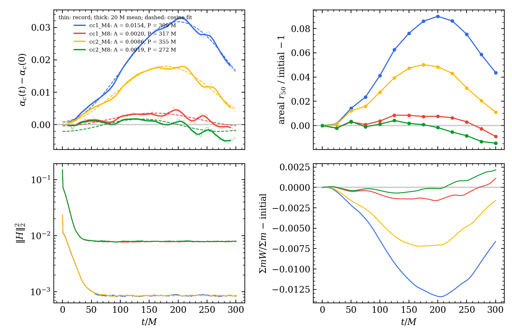

# C-sidm/drift: origin of the outward excursion of the collisionless King controls

Helper package of owner C-sidm, wave 3 (`../PLAN-wave3.md`, package 6). Question
(`../RISKS.md` item 3): the two collisionless King controls of wave 2 (cc1_kninf, y0 =
0.334032, run C-20261115-171058-c26cfad; cc2_kninf, y0 = 0.314, run
C-20261115-171059-4b70228; static mesh with M/4 cells, N = 1e5, 300 M) move their central
lapse up by 0.033 and 0.018 and back. Is this the mesh, particle noise, or a physical mode
excited by the initial data? The answer decides the mesh of block A of
`../threshold_scan/SCAN.md`.

Answer so far: the outward excursion is the mesh. On a mesh with M/8 cells in the centre it
shrinks to 0.14 (CC1) and 0.10 (CC2) of its M/4 size, for both models [VERIFIED, runs (i),
(iii)]. What remains on M/8 is a slow contraction after 200-250 M, not yet explained; run (vi)
(queued) shows whether it turns or runs away, run (v) whether it is particle-noise relaxation.

Predictions and outcomes: `JOURNAL.md` (entries 1-14). Labels: [VERIFIED] computed in the
registered run named next to it; [JUDGEMENT]; [BACKGROUND]; [TO VERIFY].

## Contents

| Path | What it is |
|---|---|
| `scripts/controls.py` | Test D1: histories, snapshots and trajectories of a control (or of a run joined with its continuation): alpha_c excursion with two fit forms, coordinate and areal radii of the mass shells, mean Lorentz factor, H-norm2, Killing-energy sum, ripple periodogram; with `--pulsation` the lowest radial-pulsation eigenvalue of the King family (tmb b = 1, three adiabatic indices and a scaled proxy) as periods in M |
| `scripts/compare.py` | Tests M8, A: several series side by side, ratios of amplitudes and periods (`--ratio`), correlation of the ripples about their 40 M running means (`--pair`), extrema of the 40 M mean, H-norm2 floors |
| `scripts/diffusion.py` | Test D2: incoherent diffusion of every particle's Killing energy (random walk from noise), its rate D and time t_D, mean energy change |
| `scripts/make_decks.py` | Writes `inputs/`: the M/8 decks, the N = 1e4 deck, one batch list per card job |
| `inputs/cc{1,2}_kninf_M8.athinput` | (iii), (i): the wave-2 control decks with a level-7 region (M/8 cells) inside \|x\|_inf < 3.9 M; output cadence in time unchanged; restart files every 100 M |
| `inputs/cc2_kninf_N1e4.athinput` | (v): the cc2 control deck with the N = 1e4 file of wave 1 (run C-sidm-20261115-120610-b4592be), all particles tracked |
| `inputs/job_{i,...,vi}.list` | one run per card job, every line ending with `-t 00:52:00`; (ii), (iv) restart the wave-2 runs at 300 M (dropped by the lead); (vi) restarts run (i) at 300 M with `time/tlim=1000` |
| `figs/` | copies of figures of the registered runs (all looked at): `fig_drift_controls`, `fig_drift_fit`, `fig_drift_pulsation` (D1b), `fig_drift_M8` (four controls, run C-20261121-140518-9812635), `fig_drift_diffusion` (D2, run C-20261121-140431-b4786c4) |

## How to rerun

From the worktree root (Python environment: `harness/bin/nrpic-env create --no-kokkos` once):

    R=/data/haiyangw/nrpic/scratch/C-sidm
    P="--kind scouting --gate G2 --package tracks/C-sidm/drift --cores 2"
    # D1 (processors, about 20 s)
    harness/bin/nrpic-run submit $P --purpose "drift D1" -- python3 tracks/C-sidm/drift/scripts/controls.py \
      --pulsation --out '$NRPIC_RUN_DIR' cc1_kninf=$R/C-20261115-171058-c26cfad/cc1_kninf \
      cc2_kninf=$R/C-20261115-171059-4b70228/cc2_kninf
    # decks and lists
    python3 tracks/C-sidm/drift/scripts/make_decks.py
    # one card job (k = i, iii, v, vi); first squeue: this package keeps at most one job queued
    harness/bin/nrpic-run submit --launcher batch --list tracks/C-sidm/drift/inputs/job_<k>.list \
      --wall 00:55:00 --gpu-hours 0.9 --exe /data/haiyangw/nrpic/.work/build_gpu_v03/src/athena \
      --kind scouting --gate G2 --package tracks/C-sidm/drift --particles 100000 --purpose "drift (<k>)"
    # the four controls on both meshes (M8 tests; about 1 min)
    harness/bin/nrpic-run submit $P --purpose "drift M8" -- python3 tracks/C-sidm/drift/scripts/compare.py \
      --out '$NRPIC_RUN_DIR' --tag cc_M8 cc1_M4=cc1:$R/C-20261115-171058-c26cfad/cc1_kninf \
      cc1_M8=cc1:$R/C-20261121-125459-f03c4ba/cc1_kninf_M8 cc2_M4=cc2:$R/C-20261115-171059-4b70228/cc2_kninf \
      cc2_M8=cc2:$R/C-20261120-222533-ce50a86/cc2_kninf_M8 --ratio cc1_M8/cc1_M4 --ratio cc2_M8/cc2_M4 \
      --pair cc1_M8/cc2_M8 --pair cc1_M4/cc2_M4 --pair cc1_M4/cc1_M8
    # D2 (about 1 min): the same four labels as LABEL=DIR, without the cc1:/cc2: model prefix
    harness/bin/nrpic-run submit $P --purpose "drift D2" -- python3 tracks/C-sidm/drift/scripts/diffusion.py \
      --out '$NRPIC_RUN_DIR' cc1_M4=$R/C-20261115-171058-c26cfad/cc1_kninf ... --ratio cc1_M8/cc1_M4

A continuation needs the executable that wrote its restart file: the batch executables of the
wave-2 runs and of run (i) and `.work/build_gpu_v03/src/athena` have the same sha256
(f9f2dc12..., JOURNAL entries 1 and 10).

## Results

| Test | Run id | Outcome |
|---|---|---|
| D1 processor analysis of the wave-2 controls | C-20261120-222211-aa1be86 (figures D1b C-20261120-223139-2526c6d) | [VERIFIED] on M/4 the excursion is a physical expansion and return of the cluster (areal r50 +9.0 % CC1, +5.0 % CC2; 0.78 of the coordinate change; mean W anti-correlated -0.998), fitted by a cosine started at a turning point: P = 399 M (CC1), 355 M (CC2); fluid fundamental mode with the F21 index 358 and 305 M. D1.1-D1.4 pass, D1.5 failed |
| M/8 deck smoke | C-20261120-222544-e5a7492 | [VERIFIED] 456 MeshBlocks on 8 levels; H-norm2(0) 6.3 times that of M/4 |
| (i) cc2_kninf_M8 | C-20261120-222533-ce50a86 (analysis C-20261121-075359-26e3b31, lead) | [VERIFIED] largest excursion 0.0018 against 0.0179 (ratio 0.10); no cosine form; contraction after 200 M (alpha_c -0.0041, areal r50 -1.5 % at 300 M); 8.30 s per M. M8.1, M8.3, M8.4 hold, M8.2 failed (entry 8) |
| (iii) cc1_kninf_M8 | C-20261121-125459-f03c4ba (analysis C-20261121-140057-92742cf; figure C-20261121-140518-9812635) | [VERIFIED] largest excursion 0.0046 against 0.0330 (ratio 0.14); cosine A ratio 0.13; contraction after 250 M (alpha_c -0.0020, areal r50 -0.9 % at 300 M); no collapse (alpha_min >= 0.659); H-norm2 floor 7.9e-3 (9.2 times M/4); 8.22 s per M. M8.1', M8.2'', M8.3', M8.4' hold; M8.2' (contracts faster than CC2) and M8.5' (ripple shared with CC2 on M/8: +0.25, not > 0.5) failed (entry 12) |
| D2 energy diffusion of all particles | C-20261121-140356-f933a0e (figure C-20261121-140431-b4786c4) | [VERIFIED] incoherent variance of the Killing energy grows linearly (a random walk): D = 4.0e-8 (CC1) and 3.8e-8 per M (CC2) on M/4, 6.5e-8 and 5.8e-8 on M/8, ratio 1.6 (not the 9 of the H-norm2 floor); t_D = var(E_K)/D = 6.2-6.4e4 M (M/4), 4.0e4 M (M/8). D2.1, D2.3, D2.4 hold, D2.2 failed (entry 14) |
| (vi) cc2_kninf_M8 continued from 300 M | C-20261121-140023-b0f113e (Slurm 4804) | pending in the queue (submitted 14:00 UTC 2026-11-21); predictions VI.1-VI.4, entry 10 |
| (v) cc2_kninf at N = 1e4, M/4 | none | not submitted (one job of this package at a time; after (vi)); predictions N.1-N.6, entries 5, 11, 14 |
| (ii), (iv) continuations of the M/4 controls | none | dropped by the C-sidm lead (`../HANDOFF.md`): the M/4 excursion is numerical |

Card-hours of this package: 0.69 (i) + 0.69 (iii) = 1.38 of 3.0 (sacct elapsed); (vi) will take
about 0.87, (v) about 0.3.

## Pending runs

Run (vi) is queued (run C-20261121-140023-b0f113e, Slurm 4804). When it has ended:

    cd /data/haiyangw/nrpic/wt/C-sidm && R=/data/haiyangw/nrpic/scratch/C-sidm
    harness/bin/nrpic-run finish C-20261121-140023-b0f113e
    harness/bin/nrpic-run submit --kind scouting --gate G2 --package tracks/C-sidm/drift --cores 2 \
      --purpose "drift VI: cc2 on M/8 joined with its continuation (entry 10)" -- python3 \
      tracks/C-sidm/drift/scripts/compare.py --out '$NRPIC_RUN_DIR' --tag cc2_M8A \
      cc2_M8A=cc2:$R/C-20261120-222533-ce50a86/cc2_kninf_M8,$R/C-20261121-140023-b0f113e/cc2_kninf_M8_A
    harness/bin/nrpic-run submit --kind scouting --gate G2 --package tracks/C-sidm/drift --cores 2 \
      --purpose "drift D2 of (vi)" -- python3 tracks/C-sidm/drift/scripts/diffusion.py --out '$NRPIC_RUN_DIR' \
      cc2_M8A=$R/C-20261120-222533-ce50a86/cc2_kninf_M8,$R/C-20261121-140023-b0f113e/cc2_kninf_M8_A

Then judge VI.1-VI.4 (entry 10). Run (v) next (first `squeue -u haiyangw -o '%i %j %T'`:
nothing if two C-* jobs are queued or running):

    harness/bin/nrpic-run submit --launcher batch --list tracks/C-sidm/drift/inputs/job_v.list \
      --wall 00:55:00 --gpu-hours 0.5 --exe /data/haiyangw/nrpic/.work/build_gpu_v03/src/athena \
      --kind scouting --gate G2 --package tracks/C-sidm/drift --particles 10000 \
      --parent C-20261115-171059-4b70228 --purpose "drift (v): cc2_kninf at N = 1e4 on M/4 (particle-number leg)"

and analyse it with `compare.py --tag cc2_N` (`cc2_N1e5=cc2:<wave-2 dir> cc2_N1e4=cc2:<run (v) dir>
--ratio cc2_N1e4/cc2_N1e5`) and `diffusion.py` (`--ratio cc2_N1e4/cc2_N1e5`) against N.1-N.6.

## Requests

To the C-sidm lead, on the mesh and N of SCAN.md block A:

1. [VERIFIED, runs (i), (iii) with C-20261121-140057-92742cf] Do not run block A on the M/4
   mesh. There the mesh pushes the collisionless controls outward (alpha_c +0.018 and +0.033,
   areal r50 +5 and +9 % within 200 M); on M/8 the same push is 7-10 times smaller. An outward
   push of that size stabilises the models and would move the fate bracket to larger y0.
2. [VERIFIED cost; JUDGEMENT on the choice] Run block A on the M/8 mesh (`make_decks.m8_deck`:
   a level-7 region inside |x|_inf < 3.9 M, 456 MeshBlocks): 8.22-8.30 s per M, i.e. 2.3
   card-hours per 1000 M run, about 23 card-hours for the ten runs of block A instead of 9.5.
   If that is too much, run M/8 only at y0 = 0.324, 0.334032, 0.344 (both kicks, 14
   card-hours) and leave 0.314 and 0.354 out until the bracket needs them.
3. [JUDGEMENT] The M/8 controls are not stationary either: both contract slowly after
   200-250 M (alpha_c -0.002 and -0.004, areal r50 -0.9 and -1.5 % at 300 M). Read every fate
   of block A against a collisionless control of the same mesh, seed and N run as long, and
   do not start block A before run (vi) shows whether this contraction turns (bounded) or
   runs away by about 650 M. If it runs away, a stable model collapses on M/8 and the bracket
   moves to smaller y0.
4. [VERIFIED, D2; JUDGEMENT on the consequence] Particle noise at N = 1e5 diffuses the
   particle energies slowly (t_D = 4e4 M on M/8, 6e4 M on M/4) and almost independently of the
   mesh (factor 1.6), so N = 1e5 stays the choice for block A unless run (v) shows that the
   contraction scales as 1/N (prediction N.6); then block A needs N = 1e6 near the threshold.
5. [VERIFIED, M8.5'] The central-lapse ripple of two models on M/8 is only weakly shared
   (+0.25), so the scatter between seeds has to be measured (your three seeds per model near
   the threshold), not taken from one seed.
6. [JUDGEMENT] The "zero of omega^2(y0)" route of my earlier request 3 (entry 4) is withdrawn:
   the 300-400 M periods are the response to the mesh-made push on M/4, and on M/8 there is no
   clean oscillation to fit.

To core: none. To orch: none.
