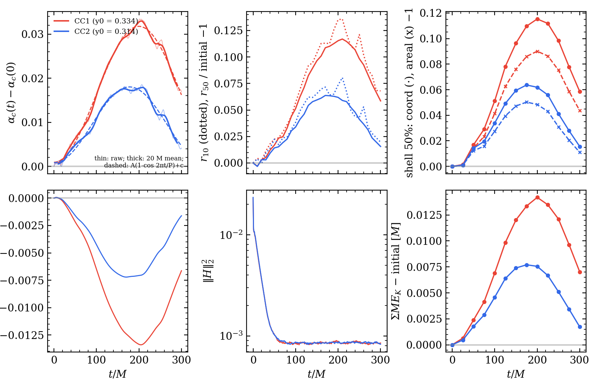

# C-sidm/drift: origin of the outward excursion of the collisionless King controls

Helper package of owner C-sidm, wave 3, round 1 (`../PLAN-wave3.md`, package 6). Question
(`../RISKS.md` item 3): the two collisionless King controls of wave 2 (cc1_kninf, y0 =
0.334032, run C-20261115-171058-c26cfad; cc2_kninf, y0 = 0.314, run
C-20261115-171059-4b70228; static mesh with M/4 cells, N = 1e5, 300 M) move their central
lapse up by 0.033 and 0.018 and back. Is this the mesh, particle noise, or a physical mode
excited by the initial data? The answer decides the mesh of block A of
`../threshold_scan/SCAN.md` (about 9.5 card-hours).

Predictions and outcomes: `JOURNAL.md` (entries 1-). Labels: [VERIFIED] computed in the
registered run named next to it; [JUDGEMENT]; [BACKGROUND]; [TO VERIFY].

## Contents

| Path | What it is |
|---|---|
| `scripts/controls.py` | Test D1: histories, snapshots and trajectories of a control (or of a run joined with its continuation): alpha_c excursion with two fit forms, coordinate and areal radii of the mass shells, mean Lorentz factor, H-norm2, Killing-energy sum, ripple periodogram; with `--pulsation` the lowest radial-pulsation eigenvalue of the King family (tmb b = 1, three adiabatic indices and a scaled proxy) as periods in M |
| `scripts/compare.py` | Tests M8 and A: several series side by side (M/4 against M/8, 0-1000 M), ratios of amplitudes and periods, extrema of the 40 M mean, H-norm2 floors |
| `scripts/make_decks.py` | Writes `inputs/`: the M/8 decks, the N = 1e4 deck, one batch list per card job |
| `inputs/cc{1,2}_kninf_M8.athinput` | (iii), (i): the wave-2 control decks with a level-7 region (M/8 cells) inside \|x\|_inf < 3.9 M; output cadence in time unchanged; restart files every 100 M |
| `inputs/cc2_kninf_N1e4.athinput` | (v), optional: the cc2 control deck with the N = 1e4 file of wave 1 (run C-sidm-20261115-120610-b4592be) |
| `inputs/job_{i,ii,iii,iv,v}.list` | one run per card job; (ii), (iv) restart the wave-2 runs from `rst/cc.00001.rst` (t = 300 M) to `time/tlim=1000`; every line ends with `-t 00:52:00` |
| `figs/` | copies of the figures of the registered runs (all looked at) |

## How to rerun

From the worktree root, Python environment of the worktree (`harness/bin/nrpic-env create
--no-kokkos` once):

    R=/data/haiyangw/nrpic/scratch/C-sidm
    # D1 (processors, 2 cores, about 20 s)
    harness/bin/nrpic-run submit --kind scouting --gate G2 --package tracks/C-sidm/drift --cores 2 \
      --purpose "drift D1" -- python3 tracks/C-sidm/drift/scripts/controls.py --pulsation \
      --out '$NRPIC_RUN_DIR' cc1_kninf=$R/C-20261115-171058-c26cfad/cc1_kninf \
      cc2_kninf=$R/C-20261115-171059-4b70228/cc2_kninf
    # decks and lists
    python3 tracks/C-sidm/drift/scripts/make_decks.py
    # one card job (k = i, ii, iii, iv, v); check squeue first: at most one job of this package
    harness/bin/nrpic-run submit --launcher batch --list tracks/C-sidm/drift/inputs/job_<k>.list \
      --wall 00:55:00 --gpu-hours 0.75 --exe /data/haiyangw/nrpic/.work/build_gpu_v03/src/athena \
      --kind scouting --gate G2 --package tracks/C-sidm/drift --particles 100000 --purpose "drift (<k>)"
    # comparison of a card run with its M/4 control (processors)
    harness/bin/nrpic-run submit --kind scouting --gate G2 --package tracks/C-sidm/drift --cores 2 \
      --purpose "drift M8 cc2" -- python3 tracks/C-sidm/drift/scripts/compare.py --out '$NRPIC_RUN_DIR' \
      --tag cc2_M8 cc2_M4=cc2:$R/C-20261115-171059-4b70228/cc2_kninf \
      cc2_M8=cc2:$R/<run (i)>/cc2_kninf_M8 --ratio cc2_M8/cc2_M4

The continuation of a wave-2 run needs the executable that wrote its restart file: the
wave-2 `batch.list.exe` and `.work/build_gpu_v03/src/athena` have the same sha256
(f9f2dc12...be3a1, JOURNAL entry 1).

## Results

State: PAUSED at 22:35 UTC on 2026-11-20 (pause flag); see JOURNAL entry 7.

| Test | Run id | Outcome |
|---|---|---|
| D1 processor analysis of the wave-2 controls | C-20261120-222211-aa1be86 (figures rerun in D1b, C-20261120-223139-2526c6d) | [VERIFIED] the excursion is a fundamental radial pulsation started at a turning point: cosine fits P = 399 M (CC1), 355 M (CC2), sine-with-trend 415 M and 393 M; amplitude A = 0.0154 and 0.0086 in alpha_c; areal radius of the 50 % shell up by 9.0 % and 5.0 % (0.78 of the coordinate change: not a coordinate drift); mean Lorentz factor anti-correlated (-0.998); H-norm2 uncorrelated (-0.49) and identical for both models; ripple rms 8e-4 (52.7-53.9 M), the same in both models (residual correlation 0.72, same seed). D1.1-D1.4 pass, D1.5 failed |
| D1/D1b pulsation periods of the King family (tmb b = 1) | C-20261120-222211-aa1be86, C-20261120-223139-2526c6d | [VERIFIED] fluid fundamental mode with the F21 index: 358 M (CC1), 305 M (CC2), 260 M (y0 = 0.26); Juttner index: CC1 unstable, CC2 793 M, y0 = 0.26 326 M; dynamical estimate 22-24 M |
| M/8 deck smoke (processors, nlim = 0) | C-20261120-222544-e5a7492 | [VERIFIED] 456 MeshBlocks on 8 physical levels; H-norm2(0) = 0.149 against 0.0235 at M/4 (particle noise of the deposit in smaller cells [JUDGEMENT]) |
| (i) cc2_kninf_M8 | C-20261120-222533-ce50a86 | queued (Slurm 4741), not run when the package paused |
| (ii)-(v) | none | not submitted (pause) |

## Pending runs

Submit one at a time (this package keeps at most one card job in the queue; first check
`squeue -u haiyangw -o '%i %j %T'`: nothing if two C-* jobs are queued or running):

    cd /data/haiyangw/nrpic/wt/C-sidm && B="--wall 00:55:00 --gpu-hours 0.75 --exe /data/haiyangw/nrpic/.work/build_gpu_v03/src/athena --kind scouting --gate G2 --package tracks/C-sidm/drift --particles 100000"
    # (ii) continuation of cc2_kninf, 300 -> 1000 M (about 41 min)
    harness/bin/nrpic-run submit --launcher batch --list tracks/C-sidm/drift/inputs/job_ii.list $B --parent C-20261115-171059-4b70228 --purpose "drift (ii): continuation A' of cc2_kninf from its restart at 300 M to 1000 M"
    # (iii) cc1_kninf on the M/8 mesh, 300 M (about 40 min at the predicted 2.3 x cost; read the cost of (i) first)
    harness/bin/nrpic-run submit --launcher batch --list tracks/C-sidm/drift/inputs/job_iii.list $B --parent C-20261115-171058-c26cfad --purpose "drift (iii): cc1_kninf on a mesh with a level-7 region (M/8) inside |x| < 3.9 M, 300 M"
    # (iv) continuation of cc1_kninf, 300 -> 1000 M
    harness/bin/nrpic-run submit --launcher batch --list tracks/C-sidm/drift/inputs/job_iv.list $B --parent C-20261115-171058-c26cfad --purpose "drift (iv): continuation A' of cc1_kninf from its restart at 300 M to 1000 M"
    # (v) optional, only within the 3.0 card-hour cap: cc2_kninf at N = 1e4, M/4, 300 M (about 17 min)
    harness/bin/nrpic-run submit --launcher batch --list tracks/C-sidm/drift/inputs/job_v.list $B --purpose "drift (v): cc2_kninf at N = 1e4 (particle-number leg)"

Analysis of each (processors, 2 cores), for example (ii):

    R=/data/haiyangw/nrpic/scratch/C-sidm
    harness/bin/nrpic-run submit --kind scouting --gate G2 --package tracks/C-sidm/drift --cores 2 --purpose "drift A cc2" \
      -- python3 tracks/C-sidm/drift/scripts/compare.py --out '$NRPIC_RUN_DIR' --tag cc2_A1000 \
      cc2_A1000=cc2:$R/C-20261115-171059-4b70228/cc2_kninf,$R/<run (ii)>/cc2_kninf_A1000

Predictions to judge: JOURNAL entry 2 (M8.1-M8.4 for (i), (iii); A.1-A.5 for (ii), (iv)),
entry 5 (N.1-N.3 for (v)), entry 6 (the decisive package's d3_kninf at y0 = 0.26).

## Requests

To the C-sidm lead (mesh of SCAN.md block A), preliminary because no M/8 run has finished:

1. [VERIFIED, D1] The excursion of the controls is not a gauge or coordinate drift and not
   a random walk: it is the fundamental radial pulsation of the cluster, started at a
   turning point, with periods of 355-415 M that sit within 10-25 % of the fluid
   fundamental mode with the model's own index (305-358 M). Its size (5-9 % in areal
   radius) is the response of a soft mode (omega^2/(4 pi rho_c) of about 0.006) to
   whatever displaces the initial state from the code's equilibrium; which displacement
   (mesh, particle noise, initial data) is still open: run (i) decides the mesh part.
2. [JUDGEMENT, JOURNAL entry 4] On the M/4 mesh the threshold model CC1 oscillates with a
   finite radial frequency (omega^2 of CC1 is 0.79 of CC2's, not zero); a straight line
   through the two points crosses zero at y0 = 0.41-0.51. If (iii) (CC1 at M/8) does not
   lengthen the period clearly, the code's collisionless onset lies above y0 = 0.334 on
   that mesh, and block A's grid (0.314-0.354) may show no collapse in 1000 M. Do not
   start block A before (i) and (iii) have run.
3. Recommendation for block A, pending (i) and (iii): measure the period of the alpha_c
   pulsation of every block-A run and locate the threshold as the zero of omega^2(y0)
   (it needs no collapse and every control provides it), in addition to the fates; and
   choose the mesh by the rule of JOURNAL entry 2 (M8.1): R <= 0.35 (second order) or
   0.35-0.65 (first order): run block A on the M/8 mesh (about 2.3 times the cost, about
   22 card-hours instead of 9.5) or as an M/4-M/8 pair at the bracket; R in 0.75-1.33:
   the mesh is not the cause, M/4 is enough for block A, and the particle-number leg (v)
   comes before the scan.
4. The decisive package's d3_kninf (y0 = 0.26, M/4) is a third point of omega^2(y0) on the
   same mesh; analyse it with `scripts/controls.py` (prediction: JOURNAL entry 6).

To core: none. To orch: none.
